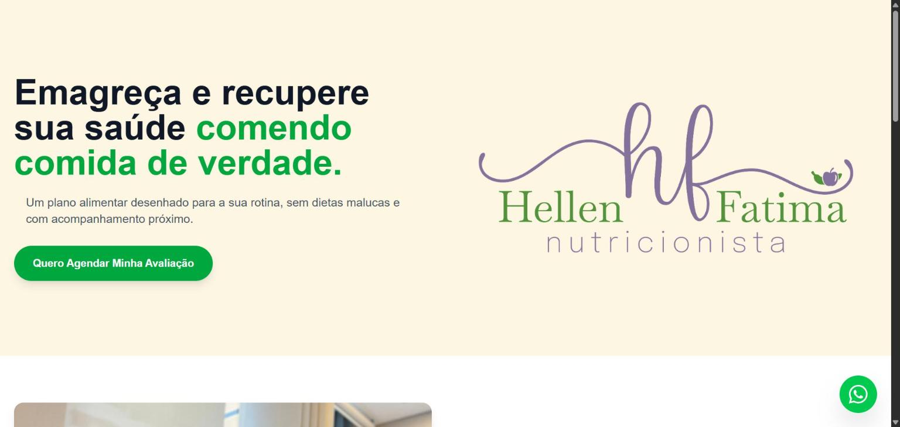

# Nutri Hellen — Site institucional e agendamento de consultas

**Em produção:** [nutrihellenfatima.com.br](https://nutrihellenfatima.com.br) · cliente real (nutricionista, CRN-3)



Landing page com captação de pacientes sem login e painel administrativo de leads, do levantamento com a cliente até o deploy em VPS.

| | |
|---|---|
| **Backend** | Laravel 12 · PHP 8.4 |
| **Frontend** | Livewire 3 · Tailwind CSS v4 (tokens de marca no CSS via `@theme`) |
| **Banco** | MariaDB (local: MySQL via Sail) |
| **Testes** | PHPUnit, testes de feature para o fluxo de agendamento e a proteção do painel |
| **Infra** | Docker/Laravel Sail (WSL2) · Dockerfile de produção (`serversideup/php` + Nginx) · Coolify em VPS DigitalOcean com deploy por webhook |

## Destaques

- **Agendamento sem fricção:** o formulário Livewire valida, grava o lead e redireciona para o WhatsApp da nutricionista com uma mensagem pronta.
- **Painel administrativo** protegido por autenticação própria, sem starter kit: marca leads como contatados em tempo real.
- **Deploy de verdade, com problemas reais resolvidos:** OOM no build (resolvido com swap), conflito entre o Nixpacks e o Nginx (substituído por Dockerfile próprio), plugin de autenticação removido no MySQL 8.4 (migração para MariaDB) e resolução de DNS entre containers.
- **SEO e conversão:** título indexável, botão flutuante de WhatsApp e textos validados pela cliente.

## Como rodar localmente

```bash
git clone https://github.com/Porzelt/Nutri-Hellen-Site.git
cd Nutri-Hellen-Site
cp .env.example .env          # se houver conflito de portas: APP_PORT=8001 e FORWARD_DB_PORT=3307
./vendor/bin/sail up -d
./vendor/bin/sail composer install
./vendor/bin/sail npm install && ./vendor/bin/sail npm run build
./vendor/bin/sail artisan migrate
./vendor/bin/sail artisan test
```

Acesse em http://localhost:8001

## 📖 Diário de bordo: decisões de arquitetura

<details>
<summary>Os desafios e as decisões técnicas de cada etapa (clique para expandir)</summary>

### 01. Infraestrutura e Isolamento de Ambiente (Docker)
**O Desafio:**
Desenvolver múltiplos projetos no mesmo ambiente (WSL2) frequentemente causa conflitos de dependências (versões do PHP) e colisão de portas.

**A Solução:**
Adotei a containerização completa utilizando **Docker** e **Laravel Sail**. Isso isola o ambiente da aplicação, garantindo que ela funcione identicamente em qualquer máquina.
- **Estratégia de Portas Customizadas:** Como já possuía microsserviços rodando nas portas padrão (80/3306), configurei o `docker-compose` (via `.env`) para expor este projeto em portas dedicadas, evitando conflitos de *binding*:
  - Aplicação Web: `:8001`
  - MySQL: `:3307`
  - Vite (HMR): `:5174`

### 02. Fluxo de Versionamento (Gitflow Adaptado)
**A Decisão:**
Para simular um ambiente profissional, aboli commits diretos na branch de produção.
- **`main`**: Código estável, pronto para deploy. Representa a "verdade" do produto.
- **`develop`**: Branch de integração onde as funcionalidades são testadas antes do merge.
Isso garante uma esteira de desenvolvimento segura e organizada.

### 03. Stack de Frontend e Compilação de Assets 
**A Decisão:**
Para manter a agilidade no desenvolvimento da interface, optei pela "TALL Stack" (Tailwind, Alpine - implícito no Livewire, Laravel, Livewire).

Configuração Técnica: Configurei o Vite para processar os arquivos do Tailwind CSS em tempo real (HMR).

Desafio: O utilitário npx apresentou falhas de resolução de binário dentro do container Docker.

Solução: Executei a inicialização do Tailwind invocando diretamente o binário local (./node_modules/.bin/tailwindcss), contornando a falha de path do ambiente virtualizado.

### 04. Identidade Visual (Tailwind v4) e Captura de Leads
**O Desafio:**
Implementar a identidade visual "Outono" (Terracota e Verde Musgo) utilizando a versão mais recente do framework (**Tailwind CSS v4**) e criar um fluxo de agendamento sem fricção (sem login).

**Decisões Técnicas:**
* **Configuração CSS-Native:** Adotei a nova arquitetura do Tailwind v4, migrando a configuração do antigo arquivo JS (`tailwind.config.js`) para variáveis de tema diretamente no CSS (`@theme`). Isso eliminou arquivos de configuração legados e simplificou a pipeline de build.
* **Design System Semântico:** Defini tokens como `--color-brand-primary` e `--color-brand-secondary`. Isso desacopla a lógica de cores do HTML, permitindo mudanças globais de marca editando apenas o CSS.
* **Estratégia "Zero-Login":** Para maximizar a conversão de pacientes, optei por um formulário stateless que:
    1.  Valida e persiste o lead no MySQL (Tabela `leads`) para controle de métricas.
    2.  Redireciona imediatamente para o WhatsApp da nutricionista com mensagem contextualizada (`redirect()->away()`), transferindo a negociação para um canal direto.

### 05. Autenticação Customizada e Área Administrativa 
**O Desafio:**
 Criar uma área restrita segura para gestão dos leads sem utilizar "Starter Kits" pesados (como Breeze ou Jetstream) que poderiam sobrescrever a customização CSS (Tailwind v4) já realizada.

**A Solução:**
Implementei um fluxo de autenticação manual utilizando **Livewire** e os recursos nativos do Laravel (`Auth::attempt`, `Middleware`).
* **Segurança:** Proteção das rotas administrativas (`/dashboard`) via middleware `auth`. Uso de *Seeders* para criação controlada do usuário admin, evitando páginas públicas de registro.
* **Dashboard Interativo:** Construção de um painel SPA (Single Page Application) com Livewire, permitindo que a nutricionista marque leads como "Contatados" em tempo real, sem recarregamento de página.
* **UX Discreta:** Implementação de um ponto de acesso administrativo oculto no rodapé, visível apenas como um ícone de cadeado para visitantes, mas que se transforma em um botão de acesso rápido quando o usuário está autenticado.

### 06. Qualidade de Software e Testes Automatizados
**O Desafio:**
Garantir a confiabilidade do fluxo crítico de negócios (Agendamento) e da segurança (Proteção do Dashboard) em um ambiente de desenvolvimento instável (Laravel 12 Alpha + PHP 8.5).

**A Solução:**
Implementei testes automatizados de integração (Feature Tests) cobrindo os cenários de sucesso e falha.
* **Pivot Estratégico (Tooling):** Inicialmente optei pelo *Pest PHP*, mas devido a conflitos de dependência com as versões *bleeding edge* do framework, migrei para o **PHPUnit** nativo. Isso garantiu a execução dos testes sem bloquear o avanço do projeto.
* **Cobertura de Testes:**
    1.  **Smoke Test:** Validação de carregamento da Landing Page (Status 200).
    2.  **Segurança:** Tentativa de acesso não autorizado ao `/dashboard` (deve redirecionar para login).
    3.  **Fluxo de Negócio:** Simulação completa de um paciente preenchendo o componente Livewire, verificando a persistência correta na tabela `leads` do MySQL.

### 07. Refinamento Visual, SEO e Validação (Release v1.5)
**O Desafio:**
Elevar o nível do MVP para um produto final de mercado, validado pela cliente real (Nutricionista), focando em conversão e identidade visual.

**A Solução:**
* **Copywriting & UX:** Reescrita total dos textos aplicando gatilhos mentais (autoridade e empatia) e criação da seção "Como Funciona" para reduzir a fricção de entrada.
* **UI Design & Assets:**
    * Integração das fotos profissionais com ajustes finos de CSS (`object-top` no Tailwind) para garantir enquadramento perfeito do rosto em qualquer tela.
    * Implementação de botão flutuante (Floating Action Button) do WhatsApp com ícone SVG limpo para conversão direta.
* **SEO Técnico:** Correção da renderização da tag `<title>`, sobrepondo as configurações padrão do Laravel (`app.name`) para garantir indexação correta no Google ("Nutricionista Hellen...").
* **Validação:** Aprovação final da stakeholder (cliente).

**Status:** Projeto PRONTO para Deploy (Go Live).

### 08. Deploy em Produção e Orquestração (Coolify & Docker)
* **O Desafio:** Levar a aplicação do ambiente local (Sail/WSL2) para um servidor de produção (VPS) mantendo o baixo custo, mas com autonomia de CI/CD (Integração e Entrega Contínuas). A Escolha: Utilizei a DigitalOcean como provedor de infraestrutura e o Coolify como orquestrador (PaaS self-hosted), evitando a complexidade de configurar servidores Linux manualmente do zero.

* **Obstáculos e Soluções de Engenharia:**

**Gerenciamento de Recursos (Swap):**

* Problema: O servidor de 2GB de RAM sofria crashes silenciosos durante o processo de build (compilação do NPM/Vite), que é intensivo em memória.

* Solução: Implementação de uma Swap Memory de 2GB via terminal Linux, dobrando a capacidade "virtual" do servidor e permitindo que o processo de build finalizasse sem estourar a memória (OOM Kill).

* **Estratégia de Build (Nixpacks vs. Dockerfile):**

* Problema: O construtor automático do Coolify (Nixpacks) gerou conflitos na configuração do Nginx (duplicate location "/") e inconsistências entre a versão do PHP instalada (8.3) e a exigida pelo composer.lock (8.4).

* Decisão Arquitetural: Abandonei a "mágica" automática e assumi o controle total criando um Dockerfile de Produção.

Stack: Baseado na imagem profissional serversideup/php:8.4-fpm-nginx, que já traz otimizações de segurança, PHP 8.4 e Nginx pré-configurado para Laravel. Isso eliminou a ambiguidade do ambiente.

Banco de Dados e Networking:

* Problema 1: A versão mais recente do MySQL (8.4) removeu o plugin mysql_native_password, quebrando a autenticação do driver padrão do Laravel.

* Problema 2: O container da aplicação não conseguia resolver o nome do host do banco de dados devido a latências na propagação do DNS interno do Docker (php_network_getaddresses).

* Solução 1: Migração estratégica para MariaDB, garantindo compatibilidade nativa e simplificada com o ecossistema Laravel.

* Solução 2: Conexão via IP Interno Estático. Ao invés de depender do nome do container, configurei o DB_HOST diretamente com o IP da rede interna do Docker, eliminando falhas de resolução dos nomes e garantindo conexão imediata.

</details>

---

Desenvolvido por **Henrique Porzelt Neto** · [LinkedIn](https://linkedin.com/in/henriqueporzelt) · [GitHub](https://github.com/Porzelt)
